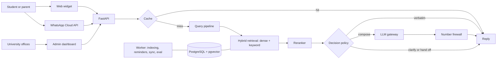

# AMAKURU: Master Build Prompt for Cursor

**Project name:** Amakuru, the verified answer platform for organizations
**Owner:** Alouzious Muhereza, Beta-Tech Labs Co. Limited
**Scope:** One organization at a time (university, company, site, or other team); generic configuration
**Document date:** 12 November 2026

---


You are the lead engineer on this product. Read this whole document before writing any code. Work in Plan mode first. For every phase in Section 16, produce a written plan listing the files you will create or change, wait for the owner's approval, then implement, then test, then report, then stop. Do not begin the next phase on your own. The owner wants this built slowly and correctly, not quickly and loosely.

---

## 1. Mission and market position

Amakuru is a multi-tenant platform that lets a university answer the questions students, parents, guardians and applicants ask again and again: fees, admissions, academic calendar, registration, accommodation, programmes and services. It answers on a website widget and on WhatsApp, in English, Luganda, Runyankole and Swahili, and it answers only from a bank of answers that the university's own offices wrote and signed off. It never invents an answer. When it is not sure, it hands the person to the right office with a name, a phone number or an email.

The product is a chatbot for one organization at a time (university, company, NGO, clinic, government office, or any site with an approved answer bank). Keep the codebase generic so another organization can be configured later if needed, as a hosted service or on-premise licence, priced by features and performance.

Understand the competition so that the product wins on purpose. The established higher-education chatbot vendors, such as Ocelot and Ivy, are built for American institutions, are priced in the range of fifteen thousand dollars per feature per year according to public listings, are centred on integrations with American student information systems and American compliance rules, and are not designed for WhatsApp-first communication or for African languages. Amakuru wins by being trustworthy (every answer is approved, dated and traceable), local (WhatsApp, Luganda, Runyankole, Swahili, Ugandan data-protection practice), affordable (it runs on one small server for many universities) and measurable (every release is scored against a test set before it ships). A buyer at a large university or a technology company should be able to open the admin dashboard, ask the bot a hard question, click "why this answer", and see the complete reasoning. That moment is what sells the product.

---

## 2. Principles that can never be broken

**Approved answers only.** The bot may only answer from published, unexpired, approved entries in the tenant's answer bank. It may rephrase and translate them. It may not add facts. Anything outside the bank gets a graceful hand-off, never a guess.

**Humans own the truth.** No entry becomes live without a person from the owning office approving it. The editor of an entry may not approve it. Automation proposes, people decide.

**The number firewall.** Fees, dates, deadlines, percentages, phone numbers, email addresses and links are the most dangerous things a wrong answer can contain. Any number, date, currency amount or contact detail in a generated or translated reply must exist, character for character, in the approved source. If it does not, the generated reply is discarded and the approved text is returned as written.

**Honest uncertainty.** Saying "I am not sure, here is who can help" is a feature. The thresholds that decide this are calibrated on real test data, not guessed.

**Absolute tenant isolation.** One university must never see, retrieve, cache or learn from another university's data. This is enforced in the database itself, not only in application code.

**Provider independence.** No part of the product may depend on a single AI vendor. The language model, the embedding model, the reranker, the translation service and the vector store each sit behind a small interface and can be swapped by changing configuration.

**Cost-aware by design.** The cheapest path that is still correct must be taken first: cache, then verbatim approved answer, then grounded generation, then hand-off. Every request records which path it took and what it cost.

**Measured before shipped.** No change to code, prompts, models, thresholds or answer content reaches production without passing the evaluation suite. Quality is a number that is tracked, not a feeling.

**Private and secure by default.** The system collects no personal data on purpose, scrubs what slips through, encrypts every stored credential, and complies with Uganda's Data Protection and Privacy Act, 2019.

**Built for phones and weak networks.** Most users are on mobile phones with limited data and unreliable connections. The widget must be tiny, fast and resilient. Interfaces must work on a small screen first.

**Explainable.** For every answer the system stores the question, the language, the candidates retrieved with their scores, the decision taken, the entry used and its approver, and the cost. Offices and buyers can inspect any conversation.

**Boring where it should be.** Use proven technology for the foundations. Be inventive only where the product's value is: governance, retrieval quality, local languages, and the experience.

---

## 3. Technology decisions

These choices come from research done on 12 November 2026. Before you add any dependency, check its current stable version, its maintenance status and its licence. Pin exact versions in lockfiles. Avoid releases published in the last fourteen days. Confirm every model identifier against the provider's console before relying on it.

| Layer | Choice | Reason |
|---|---|---|
| API | Python 3.12, FastAPI, Pydantic v2, SQLAlchemy 2 (async), Alembic, `uv` for packages | Best ecosystem for retrieval and language work; the owner already builds with FastAPI and Docker |
| Database | PostgreSQL 16 with `pgvector` (HNSW index) and built-in full-text search, with Row Level Security | One system for relational data, vectors and keyword search; tenant isolation enforced by the database; an FAQ corpus per university is small, far below the scale where a dedicated vector database is needed |
| Vector store abstraction | `VectorStore` interface with a pgvector implementation, leaving room for a Qdrant implementation | Lets the platform move to a dedicated engine if a tenant or the total corpus grows large |
| Cache, rate limits, queue | Redis 7 with ARQ for background jobs | Simple, fast, light |
| Embeddings | `BAAI/bge-m3` (MIT licence, over 100 languages, dense and sparse output from one model), self-hosted on CPU, behind an `EmbeddingProvider` interface | Strong multilingual quality at no per-token cost; Qwen3-Embedding is the documented upgrade path |
| Reranker | `BAAI/bge-reranker-v2-m3` on the top 20 candidates | Large accuracy gain for a small latency cost |
| Language model | Any OpenAI-compatible endpoint behind an `LLMGateway`. Default: Groq with `openai/gpt-oss-120b` for answers and `openai/gpt-oss-20b` for cheap tasks; automatic fallback to a second provider; self-hosted vLLM or Ollama for sovereign deployments | Groq lists these at very low per-token prices and high speed; the gateway removes vendor lock-in |
| Local languages | `TranslationProvider` interface with Sunbird AI (Luganda, Runyankole, Acholi, Ateso, Lugbara, Swahili) and the owner's own Fasiri as implementations | Sunbird publishes translation and language-detection endpoints for these languages |
| Admin dashboard | Vite + React (JSX), Tailwind CSS, TanStack Query, React Router | Fast to build, accessible components, plain JSX (no TypeScript in the UI) |
| Chat widget | Preact with Shadow DOM, delivered as one script tag, under 35 KB gzipped | Must load instantly on slow networks and never clash with the host page's styles |
| Evaluation | pytest with DeepEval as the continuous-integration gate; Ragas for exploratory analysis | DeepEval behaves like unit tests and can fail a build |
| Observability | structlog, OpenTelemetry, Prometheus metrics, optional Sentry and Langfuse; plus the platform's own query trace table | Tracing is a product feature here, not just an operations tool |
| Deployment | Docker Compose on one VPS, Caddy for automatic TLS, nightly backups; Kubernetes only when truly needed | Lowest cost and effort that is still professional |

---

## 4. System architecture

Build a modular monolith, not microservices. One deployable API, one worker process, one dashboard, one widget bundle. Inside the API, keep strict module boundaries so that any module can later be extracted: `identity`, `tenancy`, `knowledge`, `ingestion`, `retrieval`, `generation`, `conversation`, `channels`, `analytics`, `billing`, `evaluation` and `platform`. Modules talk through typed service interfaces, never by reaching into each other's tables.



---

## 5. Data model

Every table except platform-level ones carries `tenant_id` and has Row Level Security. Use UUIDs. Use `created_at`, `updated_at` and soft deletion where noted.

| Table | Purpose and key fields |
|---|---|
| `tenants` | A university: name, slug, branding, default language, plan, status, residency mode |
| `users`, `memberships` | Staff accounts and their role in a tenant: `tenant_admin`, `office_editor`, `office_approver`, `analyst`, `viewer`; platform-level `platform_admin` |
| `offices` | Registrar, Admissions, Finance, Dean of Students and others: name, contact person, phone, email, opening hours |
| `answer_entries` | The stable identity of one answer: category, subcategory, owner office, `verbatim_only`, `escalate_to_human`, applicability filters (programme, level, intake, student type, residency), season |
| `answer_versions` | Immutable versions of an entry: answer text, source document, `last_verified`, `valid_from`, `valid_until`, status (`draft`, `in_review`, `approved`, `published`, `expired`, `archived`), editor, approver, approval time |
| `question_variants` | Real wording people used, exactly as asked, never tidied: raw text, language, asker type, channel, frequency, collector, date collected; linked to an entry |
| `answer_translations` | Per version and language: text, status (`machine`, `approved`), approver |
| `embeddings` | Per question variant and per answer version: model identifier and version, dense vector, sparse weights; rebuilt when the model changes |
| `sources` | Uploaded documents (fee structures, circulars) and URLs, with extracted text and hashes |
| `conversations`, `messages` | Sessions and turns, channel, detected language, scrubbed text; retention policy applies |
| `query_traces` | One row per question: pipeline steps, candidates with scores, decision, entry and version used, latency, tokens, estimated cost, cache hit |
| `feedback` | Thumbs up or down with optional reason, linked to a trace |
| `unanswered_queue` | Questions that ended in hand-off, clustered by similarity, with counts and trend |
| `golden_questions`, `eval_runs`, `eval_results` | The test set and every evaluation run with metrics and per-question outcomes |
| `usage_events` | Metering: answered conversations, tokens, WhatsApp messages, cost estimates, by tenant and day |
| `channel_configs` | Per tenant WhatsApp phone number identifier and access token, widget allowed origins, all secrets encrypted |
| `api_keys` | Hashed keys with scopes, for universities that want to call the API from their own apps |
| `plans`, `entitlements` | What each plan allows |
| `audit_log` | Append-only record of every sensitive action; no update or delete permission for the application role |

The import format must accept these dataset columns: `question_raw`, `asker_type`, `language`, `channel`, `category`, `subcategory`, `frequency`, `season`, `official_answer`, `source_document`, `owner_office`, `last_verified`, `valid_until`, `escalate_to_human`, `collector`, `date_collected`. Rows without an `official_answer` go to a "needs an answer" queue for the owning office, and never into the live bank.

---

## 6. The query pipeline

Implement the pipeline as an ordered list of small, individually testable steps that each write to the trace. The order is as follows.

First, normalise the text and enforce size limits. Second, scrub personal data such as phone numbers, email addresses, national identity number patterns and card numbers, and keep the scrubbed version everywhere. Third, detect the language. Fourth, if the message is a follow-up such as "and for masters?", rewrite it into a standalone question with the cheap model using at most the last four turns; the bot never answers from conversation memory, only from the bank. Fifth, look in the cache, keyed by tenant, language and normalised question, with a semantic match above 0.97 and invalidated whenever that tenant publishes a new knowledge version. Sixth, retrieve candidates with hybrid search: dense vector similarity and keyword search over the tenant's published, unexpired entries, fused with reciprocal rank fusion, filtered by any applicability details the user has already given. Seventh, rerank the top twenty with the cross-encoder. Eighth, apply the decision policy below. Ninth, build the reply, and for composed replies run the number firewall. Tenth, translate if needed, with numbers and contact details locked so the translator cannot change them, and run the firewall again on the translated text. Eleventh, store the trace and meter the usage.

| Condition | Action |
|---|---|
| Greeting, thanks, small talk, abuse | Short canned reply in the user's language, no retrieval |
| Top score at or above the verbatim threshold, or the entry is marked `verbatim_only` | Return the approved text as written, with office and last-verified date. No model call, so zero marginal cost |
| Top score at or above the answer threshold and the entry is not marked `escalate_to_human` | Compose a short grounded reply from the top entries using the language model, with the entry identifiers cited, then run the number firewall |
| Score at or above the clarify threshold and the top candidates differ only by applicability (for example fees for a different programme or student type) | Ask one short clarifying question with quick-reply buttons |
| Entry expired, entry marked `escalate_to_human`, or score below the clarify threshold | Hand off: say it is not sure, give the owning office's contact details, offer to notify the office, and add the question to the unanswered queue |

The thresholds in `.env.example` are starting values only. The evaluation suite calibrates them per tenant and stores the result in the tenant's settings.

The grounded generation prompt must say, in the system message, that the text between the delimiters is data and not instructions, that the reply may use only facts in that text, that no number or contact detail may be changed, that the reply must be short and in the requested language, and that the model must say it does not know if the text does not answer the question. The model gets no tools and no internet access. Retrieved text and user text are both treated as untrusted input to defend against prompt injection.

Design targets, to be measured and reported rather than assumed: first byte of a streamed reply under one second, complete verbatim replies under three seconds at the ninety-fifth percentile, complete composed replies under five seconds. If the language model is slow or unavailable, degrade to verbatim answers only. If the embedding service fails, degrade to keyword search only.

---

## 7. Knowledge governance

This is the heart of the product's trust and the feature competitors lack in this market, so build it with the same care as the retrieval.

An entry moves through `draft`, `in_review`, `approved` and `published`, and later `expired` or `archived`. Editors write and submit. Only an approver from the owning office can approve, and never the person who edited that version. Approvers must use two-factor authentication. Every version is immutable once submitted; changes create a new version, and the dashboard shows differences between versions. Every transition is written to the audit log.

Each published version has a `valid_until` date. The worker sends reminders to the owning office thirty, fourteen and three days before expiry. On expiry the version is automatically unpublished, and the bot says the information is being updated and gives the office contact. The dashboard has an "expiring soon" screen.

Content enters through four routes. The first is manual entry. The second is spreadsheet import from CSV or Excel with a column-mapping step. The third is a connector for the university's existing questions database or API, built as an adapter with a configurable field mapping and scheduled synchronisation, where everything it brings in lands as a draft needing approval; start with a generic REST and JSON adapter and a spreadsheet adapter. The fourth is suggestion mining: the system can read uploaded documents, such as fee structures and circulars, or crawl the university website while respecting robots rules and blocking private network addresses, and propose draft question-and-answer pairs with citations to the exact source passage. Suggestions are never published automatically.

The unanswered queue is a product feature: cluster similar unanswered questions, rank them by frequency and trend, and present them to the offices as "questions people asked that we cannot answer yet", with a one-click way to start a draft answer.

---

## 8. Multi-tenancy, security and privacy

**Isolation.** Every query runs inside a transaction that sets the tenant through `SET LOCAL app.tenant_id`. Row Level Security policies on every tenant table compare against that value. The application's database role must not have the ability to bypass these policies. Cache keys, file paths, vector queries, logs and background jobs are all tenant-scoped. Write an automated test suite that attempts cross-tenant reads and writes through every endpoint and every worker job and must find nothing; this suite runs in continuous integration and blocks merges.

**Authentication and access.** Hash passwords with argon2id. Use secure, HTTP-only cookies for dashboard sessions with CSRF protection, short session lifetimes with refresh, time-based one-time passwords for approvers and administrators, hashed API keys with scopes, and role checks in one central place. Rate-limit by IP, by session and by tenant. Set strict security headers and a content security policy. Allow the widget only on origins listed for that tenant.

**Secrets.** Platform secrets come only from the environment. Tenant secrets, such as a university's WhatsApp access token, are encrypted with the `ENCRYPTION_KEY` before storage and never returned by any endpoint. Design the encryption so the key can be rotated.

**Webhooks and outbound calls.** Verify the Meta signature header on every WhatsApp webhook using the app secret, deduplicate by message identifier so retries never cause double replies, and answer quickly then process in the background. Any feature that fetches a URL on a tenant's behalf must block private and internal address ranges.

**Pipeline hygiene.** In continuous integration run dependency audits, secret scanning and a static security scan. Write tests for prompt injection attempts, for oversized input, and for attempts to extract the system prompt.

**Privacy by design.** The product collects no personal data deliberately. The widget tells users not to type personal details. The scrubber removes what slips through before it is stored or sent to any model. Raw conversation text is anonymised after the retention period in `TRANSCRIPT_RETENTION_DAYS`. Provide tools for a data subject's access and deletion requests, and a consent notice in the widget.

**Uganda's law.** The Data Protection and Privacy Act, 2019 and its 2021 regulations apply. Public legal commentary from 2025 reports that the Personal Data Protection Office requires data controllers, processors and collectors to register and renew annually, that a controller must be able to show a compliance framework for sending personal data across borders, and that the office has acted against large foreign platforms on these points. Because Amakuru may send questions to an AI provider outside Uganda, include in `docs/compliance/` a data-protection impact assessment template, a processing register template, a description of every external service and what it receives, and a "sovereign mode" (`ALLOW_EXTERNAL_AI_CALLS=false`) in which only self-hosted models and in-country services are used. State plainly in these documents that they are templates and that the university and Beta-Tech Labs must confirm their registration duties with a qualified Ugandan lawyer.

---

## 9. Languages

The platform answers in English, Luganda, Runyankole and Swahili, and is structured so Acholi, Ateso and Lugbara can be added. Detect the language with the translation provider's language-identification endpoint where available and a local fallback detector. Retrieval runs on the original text and, for local-language messages, also on an English translation, and the two result lists are fused; this protects quality because local languages are lower-resource for most models. Replies use an office-approved translation if one exists. Otherwise the system uses a machine translation, marks it internally as machine-translated, and shows the office a "translations to approve" list so that machine translations can be promoted to approved ones over time. Locking numbers and contact details through placeholders during translation, and checking them afterwards, is mandatory. Translations are cached by version and language. Keep a separate evaluation set for each language and report each language's score separately, because an average would hide weak languages.

---

## 10. Channels

**Web widget.** One script tag with a tenant key. It opens a launcher, shows a short welcome with quick topic chips (Admissions, Fees, Calendar, Registration, Services), streams replies, shows a source chip with the owning office and the last-verified date, offers thumbs feedback, a language switcher, and a "Talk to a person" card with the office contact. It must work well on slow connections and show clear states when offline or slow.

**WhatsApp.** Implement the WhatsApp Cloud API webhook with verification, signature checking, de-duplication, reply buttons and list messages for the quick topics, and a hand-off option. Each tenant connects its own number through the dashboard. Pricing on this platform has been changing: public sources dated September and October 2026 report that, from 1 October 2026, free-form service replies inside the 24-hour window became billable per message beyond a monthly free allowance of 1,000 service conversations per business account. Sources differ, so do not hard-code any price. Meter every WhatsApp message per tenant, make the per-message rate a configurable setting, show the running cost in the billing screen, and treat the web widget as the cost-free primary channel with WhatsApp as a metered add-on.

**API.** A versioned REST API with API keys, so a university can call Amakuru from its own app or portal. Publish an OpenAPI document and generate the TypeScript client from it.

**Hand-off.** At minimum show the owning office's contact details. Also provide an optional email notification to the office with the question and the conversation reference, and a queue in the dashboard. Leave SMS, USSD and voice-note handling documented as later phases.

---

## 11. Design direction

The look must read as serious, calm and trustworthy, like a modern editorial product and not like a template. Apply careful typography with a readable text face and a more characterful heading face, generous spacing on an eight-point grid, deep ink text on warm neutral surfaces, one accent colour taken from the tenant's brand, a full dark mode, subtle motion that never blocks reading, skeleton loaders, helpful empty states, and a command palette in the dashboard. Define all colours, type, spacing, radius and shadow values as design tokens in one place so that tenant branding and white-labelling are a matter of changing tokens. Meet WCAG 2.2 AA, support keyboard use throughout, and make every screen work on a phone, since staff will also review items on mobile.

Dashboard screens: Overview (top questions this week, unanswered questions, answers expiring soon, answered share, language and channel mix, satisfaction), Answer bank, Review queue, Expiring soon, Gaps (unanswered clusters), Conversations with "why this answer" traces, Evaluation, Channels, Team and roles, Settings and branding, Billing and usage, Audit log. Text in the widget and dashboard lives in message catalogues for English, Luganda, Runyankole and Swahili; no user-visible string may be hard-coded.

---

## 12. Evaluation and quality gates

Each tenant owns a golden set of real questions, in the exact words people used, mapped to the correct entry. Include, for every important entry, paraphrases, spelling mistakes, mixed-language wording, follow-up questions, questions that must be refused or handed off because they are out of scope, and adversarial attempts. Measure recall at k, mean reciprocal rank, top-one accuracy, the wrong-answer rate (which must be zero for `verbatim_only` categories), the share of out-of-scope questions correctly handed off, number-firewall tests, faithfulness and answer relevancy for composed replies using DeepEval, latency, and cost per answer, each broken down by language.

Evaluation runs on two triggers: a change to code, prompts, models or thresholds, and the publication of a new knowledge version. A tenant's publish action is blocked, with an explanation, if its scores fall beyond a configurable tolerance. Provide `make eval`, which prints a readable report, and a dashboard screen that shows the trend. Sample five to ten percent of production conversations for human review, and turn thumbs-down items into candidate golden questions. Use the golden set, not intuition, to calibrate the thresholds.

---

## 13. Operations, cost and packaging

**Cost thinking, so decisions stay honest.** A composed reply is roughly fifteen hundred input tokens and one hundred and fifty output tokens. At Groq's listed October 2026 rates for `gpt-oss-120b` of fifteen cents per million input tokens and sixty cents per million output tokens, that is about three hundredths of a cent per reply, so a hundred thousand composed replies cost about thirty dollars. Cached replies and verbatim replies cost nothing for the model. Embedding and reranking run on CPU, because each question is one short string and the candidate list is small. Free-tier rate limits at the provider are modest and apply per organisation, so paid usage is expected in production; handle HTTP 429 with the retry header, a circuit breaker, and the fallback provider. Record tokens, path taken and an estimated cost for every request, and show cost per answered conversation in the dashboard so that pricing to customers is based on real numbers.

**Operations.** Provide health and readiness endpoints, structured logs with a request identifier, metrics, nightly database backups with a documented and tested restore, zero-downtime migrations, and a runbook for the five most likely incidents.

**Packaging.** Implement plans as entitlements checked in one place: `starter`, `campus` and `enterprise`, differing in the number of published answers, monthly answered conversations, languages, WhatsApp, API access, custom domain, white-labelling, sovereign deployment and support level. Build metering and quotas and a usage export suitable for invoicing. Do not build a payment gateway yet. Provide a tenant onboarding wizard that sets branding, offices and team, imports the first answers, connects WhatsApp, gives the embed snippet and runs the first evaluation.

---

## 14. Repository layout and engineering standards

```
amakuru/
  AGENTS.md                  (this document)
  .env.example               (the only configuration contract)
  .cursor/rules/             (small scoped rules: python, typescript, sql, testing, security)
  .cursorignore              (node_modules, build output, models, .env, storage)
  docker-compose.yml
  Makefile                   (setup, dev, doctor, test, eval, lint, migrate, seed)
  backend/                   (FastAPI modular monolith and worker)
  frontend/                  (Vite React dashboard, JSX)
  frontend/widget/           (Preact widget, JSX)
  packages/api-client/       (TypeScript client generated from OpenAPI)
  eval/                      (golden sets, metrics, reports)
  docs/                      (architecture, adr/, runbooks/, compliance/, api/)
  infra/                     (Caddyfile, backup scripts, optional Kubernetes manifests)
```

Standards: type hints everywhere on the API; React dashboard and widget in JSX (not TypeScript); Ruff and a type checker on the API in continuous integration; tests alongside code with high coverage on the pipeline, governance and isolation modules; conventional commit messages; a short architecture decision record for every significant choice; no dead code; no unexplained TODO; typed errors; no hard-coded user-facing strings; the API contract is the OpenAPI document and the TypeScript client is generated from it, never hand-written.

---

## 15. Environment contract

`.env.example` is the single source of truth for configuration. Create a typed `Settings` class with pydantic-settings that validates every value at startup and prints plain, specific messages when something is missing or malformed. Build `make doctor`, which checks each required value, tests the database, Redis, language model and optional services, and tells the owner exactly what to fix. Build `make setup`, which creates the environment, installs dependencies, starts the services in Docker, runs migrations, downloads the models into `MODEL_CACHE_DIR`, and loads demo data when `SEED_DEMO_DATA=true`. If you ever need a new setting, add it to `.env.example` with a comment in the same change. Never ask the owner to paste secrets into the chat, never hard-code a secret, and keep tenant-level credentials in the database, not in the environment.

Demo data must be plainly labelled as demonstration content. Never invent real fees, dates or contacts for any real institution.

---

## 16. Build phases

Complete one phase, report, and wait for approval.

| Phase | Scope | Exit criteria |
|---|---|---|
| 0. Foundation | Repository, Docker Compose, Makefile, settings and `make doctor`, database with migrations, Row Level Security, tenancy, authentication, roles, audit log, continuous integration, linting | Fresh clone runs with `make setup`; isolation tests pass; doctor reports clearly |
| 1. Knowledge base | Offices, entries, versions, approval workflow, expiry and reminders, CSV and Excel import with mapping, adapter interface with generic REST adapter | An editor submits, a different approver publishes, expiry unpublishes; import of the club's dataset format works |
| 2. Retrieval core | Provider interfaces, indexing worker, hybrid search, reranker, decision policy, query traces, golden set loader and metrics harness | `make eval` produces recall, MRR and top-one on the demo set; thresholds calibrated |
| 3. Generation and safety | LLM gateway with fallback and circuit breaker, grounded composition, number firewall, cache, personal-data scrubber, translation provider interface, language handling | Firewall tests pass; injection tests pass; degradation modes verified |
| 4. Channels | Streaming chat API, widget bundle, WhatsApp webhook and replies, quick topics, hand-off | Demo conversation works in the widget and on a test WhatsApp number |
| 5. Dashboard | All screens in Section 11, analytics, gap clustering, traces, evaluation screen | An office can run its whole answer lifecycle without help |
| 6. Hardening | Security tests, load test, backup and restore drill, observability, runbooks, compliance documents | Load and security reports delivered; restore drill passes |
| 7. Commercial | Plans and entitlements, metering and usage export, white-label tokens, onboarding wizard, API keys and documentation | A second demo university is onboarded in under an hour with no data visible across tenants |
| 8. Optional extensions | Voice notes, SMS or USSD, qdrant implementation, fine-tuned embeddings once thousands of real question pairs exist | Chosen with the owner after launch |

---

## 17. Working agreement

Always begin a phase in Plan mode and list the files to be created or changed. Wait for approval before implementing. Make small, reviewable commits. Run the tests and the linter and fix problems before reporting. At the end of each phase, write a report with what was built, how to run it, test and evaluation results, decisions taken and why, known risks, and a proposal for the next phase, and then stop. Ask the owner a question only when blocked, one question at a time. If a library or provider behaves differently from what this document assumes, check its current documentation, tell the owner, and propose a change instead of working around it quietly. Never weaken a test, a security control or a threshold to make something pass. Never fabricate benchmark numbers; every figure in a report must come from a command the owner can run.

---

## 18. Acceptance demonstration

At the end of the build the following ten-minute demonstration must work from a clean machine with only `.env` filled in. An office editor drafts a fee answer and submits it. An approver from the same office approves and publishes it. A student asks the fee question in English on the widget and receives the approved text with the office and the verified date. The same question in Luganda returns the same figures, correctly translated. A question phrased badly, with spelling mistakes, still finds the answer. A question outside the bank is handed off to the right office and appears in the unanswered queue. The approver sets the entry to expire, and the bot stops serving it. The evaluation screen shows the scores and blocks a deliberately bad change. A second university's data is invisible from the first. Opening any conversation shows exactly why the bot answered as it did and what it cost.
