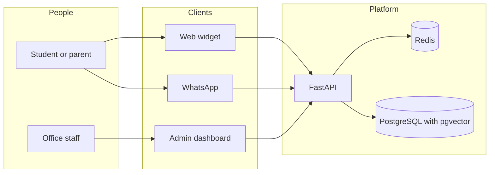
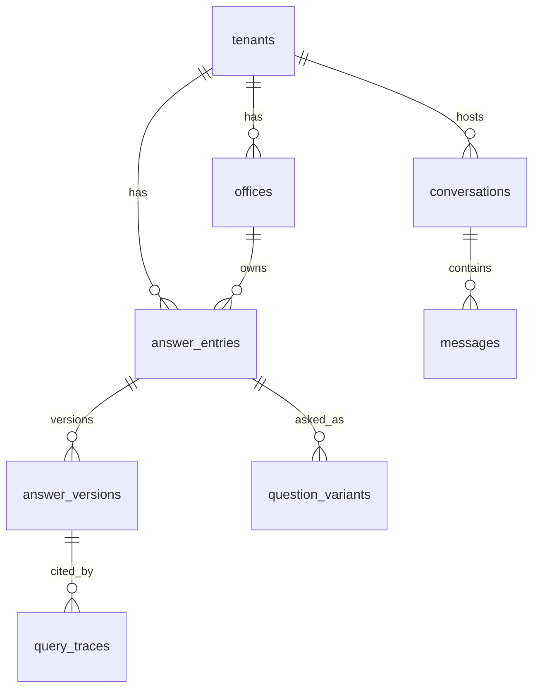
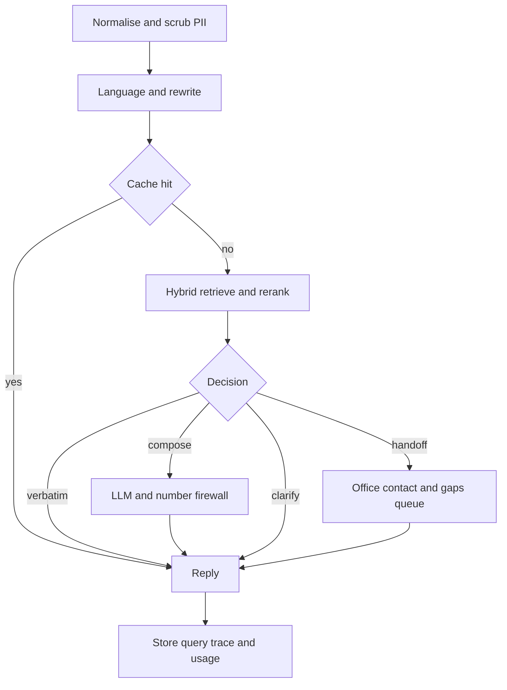
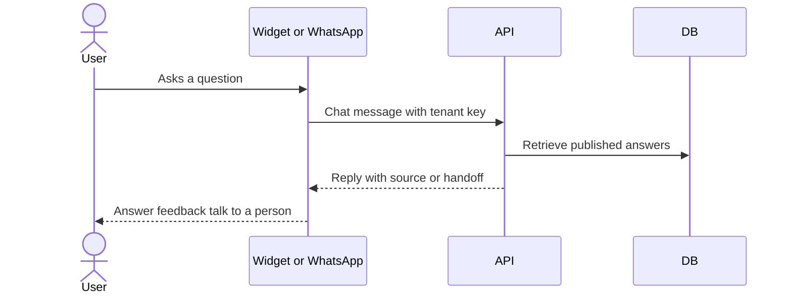
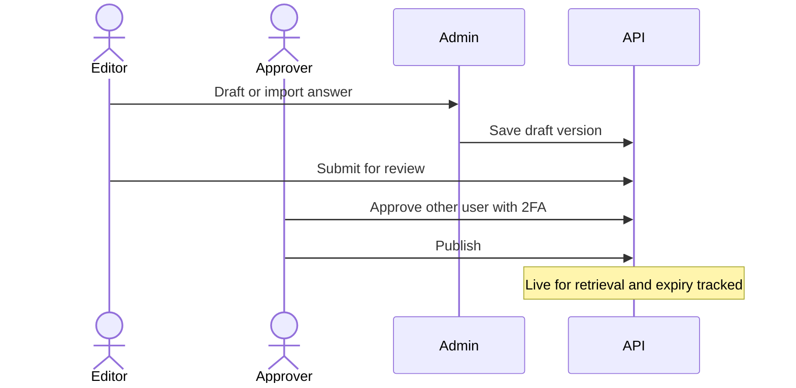

# Amakuru

**Verified answers for universities.** A multi-tenant platform that answers the questions students, parents, guardians and applicants ask again and again (fees, admissions, calendar, registration, accommodation, programmes, services).

Answers come only from a bank the university’s own offices wrote and signed off. The product never invents facts. When it is unsure, it hands the person to the right office with a name, phone or email.

Built for African campuses first: **WhatsApp**, **English / Luganda / Runyankole / Swahili**, affordable single-VPS hosting, and explainable “why this answer” traces for offices and buyers.

First customer design target: **Kabale University, Uganda**. Owner: Beta-Tech Labs Co. Limited with the IndabaX Kabale AI Club.

---

## What you get

| Surface | Role |
|---------|------|
| **Web widget** | One script tag; mobile-first; streams replies; feedback; hand-off card |
| **WhatsApp** | Cloud API webhook, quick topics, metered add-on |
| **Admin dashboard** | Answer bank, review, expiry, gaps, conversations + traces, eval, team, billing |
| **External API** | Versioned REST + API keys (`POST /api/v1/external/ask`) |
| **Governance** | Draft → review → approve → publish; editor cannot approve their own version |

Core promises:

- **Approved answers only:** rephrase/translate allowed; new facts are not
- **Number firewall:** fees, dates, phones, emails and links must match the approved source character-for-character
- **Tenant isolation:** Postgres Row Level Security; one university never sees another’s data
- **Provider independence:** LLM, embeddings, translation and vector store sit behind interfaces
- **Measured before shipped:** golden-set evaluation gates publish and releases

---

## Architecture

Modular monolith: one API, one worker, one dashboard, one widget.

### System context



| Layer | Choice |
|-------|--------|
| API | Python 3.12, FastAPI, SQLAlchemy 2 async, Alembic, `uv` |
| DB | PostgreSQL 16, pgvector (HNSW), full-text search, RLS |
| Cache / jobs | Redis 7, ARQ |
| Admin | Next.js (App Router), TypeScript, Tailwind, TanStack Query |
| Widget | Preact + Shadow DOM, single script tag |
| Deploy | Docker Compose + Caddy (TLS) |

**Repo:** `apps/api` · `apps/admin` · `apps/widget` · `packages/api-client` · `eval/` · `docs/` · `infra/`

**Modules:** `identity`, `tenancy`, `knowledge`, `retrieval`, `generation`, `channels`, `billing`, `analytics`, `evaluation`, `platform`.

### Data model (ERDs)

Full entity-relationship diagrams - **tenancy & access**, **knowledge bank**, **retrieval & eval**, **channels**, **billing** - each with a table explaining every entity:

→ **[docs/architecture/data-model.md](docs/architecture/data-model.md)**

Core knowledge shape (see the doc for the full ERDs):



Also: [architecture overview](docs/architecture/overview.md) (pipeline, isolation, modules) · [ADRs](docs/adr/).

---

## How a question is answered



1. Normalise and size-limit; scrub personal-data patterns  
2. Detect language; rewrite follow-ups into a standalone question  
3. Cache lookup (tenant + language + question)  
4. Hybrid retrieval (dense + keyword, RRF) then rerank  
5. Decision: greeting · **verbatim** · **compose** (+ number firewall) · clarify · hand-off  
6. Optional translate (numbers locked); store **query trace** (candidates, scores, cost, path)

Every answer is inspectable in the dashboard under Conversations → “why this answer”.

---

## User flows

### Student / parent (widget or WhatsApp)



1. Asks in their language on the site or WhatsApp  
2. Sees a short reply with optional source chip (office + last verified)  
3. Can thumbs-up/down, switch language, or use “Talk to a person”  
4. Out-of-bank questions go to **Gaps** for offices  

### Office editor → approver



1. Editor drafts or imports (CSV/Excel mapping)  
2. Submits (`draft` → `in_review`)  
3. A **different** office approver approves  
4. Publish; versions immutable; expiry reminders at 30 / 14 / 3 days  

### Platform / tenant admin

1. Onboard (`/onboard` or `POST /api/v1/onboarding`) - branding, offices, admin, widget key  
2. Choose plan (`starter` / `campus` / `enterprise`)  
3. Connect channels, invite team, run evaluation  
4. Billing: usage meters, CSV export, API keys  

### External integrator

1. Create an API key (campus+ plans)  
2. `POST /api/v1/external/ask` with `Authorization: Bearer ak_api_…`  
3. Receive reply, decision, trace id, optional hand-off  

---

## Plans (entitlements)

| | Starter | Campus | Enterprise |
|--|---------|--------|------------|
| Published answers | 100 | 1 000 | 10 000 |
| Answered chats / month | 2 000 | 25 000 | 500 000 |
| Languages | EN | EN + LG + NYN + SW | + Acholi, Ateso, Lugbara |
| WhatsApp / API keys | n/a | ✓ | ✓ |
| White-label / sovereign | n/a | n/a | ✓ |

No payment gateway in-repo; metering and usage export support off-platform invoicing.

---

## Quick start

**Prerequisites:** Docker Compose, Node 20+, Python tooling via `uv` (Makefile can use a local `.tools/bin/uv`).

```bash
cp .env.example .env          # or: make setup (creates .env + secrets)
make setup                    # deps, Postgres/Redis, migrate, seed
make doctor
make dev                      # API → http://localhost:8000
cd apps/admin && npm install && npm run dev   # → http://localhost:3000
cd apps/widget && npm install && npm run build
```

Default bootstrap admin after seed:

- Email: `admin@example.com`  
- Password: `ChangeMeNow123!`

Demo tenants (labelled **demonstration only** - not real university data):

| Slug | Notes |
|------|--------|
| `demo-university` | Default plan from `DEFAULT_PLAN` |
| `demo-college` | Campus plan; second-tenant isolation demo |

Widget demo key (university): `ak_live_demo_university_key_change_me`  
Open `http://localhost:8000/widget/demo` after building the widget.

**Do not commit `.env`.** Never invent real Kabale fees, dates or contacts in demos.

### Useful commands

| Command | Purpose |
|---------|---------|
| `make doctor` | Validate settings, DB, Redis |
| `make test` | Pytest (unit + isolation + security) |
| `make eval` | Golden-set retrieval metrics |
| `make lint` | Ruff, mypy, admin lint |
| `make migrate` / `make seed` | Schema + demo data |
| `make backup` / `make restore-drill` | Postgres backup & restore drill |
| `make load-test` | Concurrent chat load (API must be up) |
| `make openapi` / `make api-client` | Export OpenAPI + generate TS types |

API docs (non-production): `http://localhost:8000/docs`

---

## Security & privacy

- Argon2id passwords, HTTP-only session cookies, CSRF, TOTP for approvers/admins  
- Widget origin allow-list; WhatsApp Meta signature verification + dedupe  
- Personal-data scrubber before storage / model calls  
- Uganda DPPA templates under [docs/compliance/](docs/compliance/) (templates only - confirm with counsel)  
- `ALLOW_EXTERNAL_AI_CALLS=false` for sovereign / in-country model mode  

Incident runbooks: [docs/runbooks/](docs/runbooks/).

---

## Configuration

`.env.example` is the configuration contract. Typed settings load at API startup (`make doctor` explains missing values). Tenant secrets (e.g. WhatsApp tokens) are encrypted in the database, not the environment.

---

## Contributing / agents

Engineering standards and the full product brief live in [`AGENTS.md`](AGENTS.md). Prefer small, reviewable changes; do not weaken isolation tests, firewalls or evaluation thresholds to make a run pass.

---

## Licence & contact

Proprietary product of **Beta-Tech Labs Co. Limited**. For partnership or deployment questions, contact the project owner.
