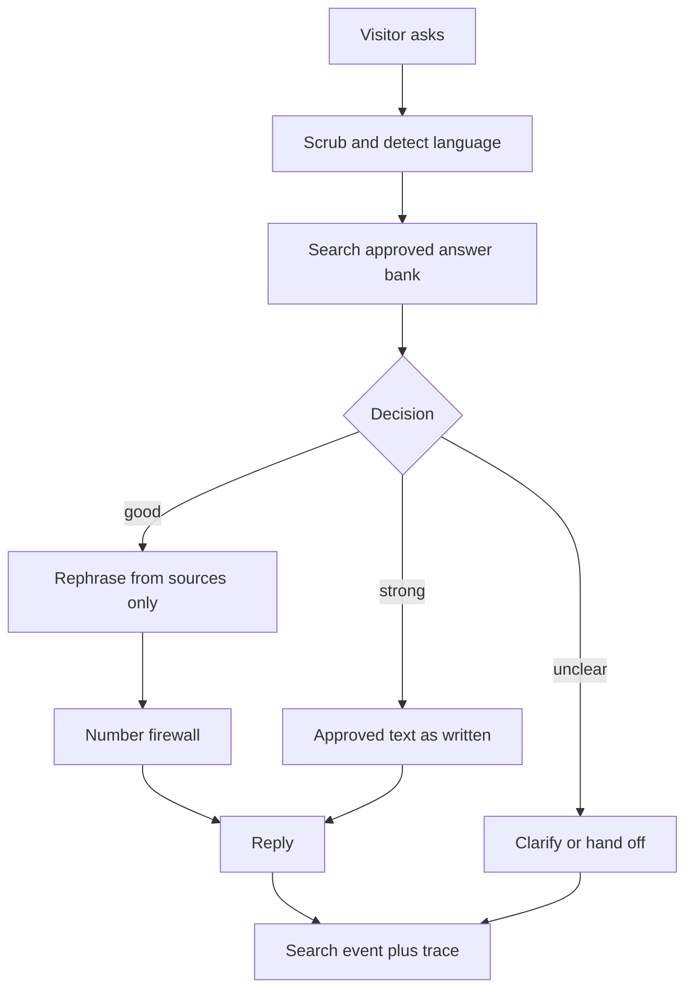

# Amakuru

**Verified FAQ assistant for organizations** — universities, companies, NGOs, clinics, government offices, and any website that needs trustworthy answers.

Staff approve answers. The bot answers from that bank only. It does not invent facts. When it is unsure, it hands the person to the right team with contact details.

One organization at a time. Same product works for a campus, a company site, or any team with an approved knowledge base.

---

## What you get

| Surface | What it does |
|---------|----------------|
| **Chat widget** | One script tag on any website. Floating popup. Mobile-friendly. |
| **WhatsApp** | Optional Cloud API channel |
| **Admin dashboard** | Answer bank, review, connectors, live searches, gaps, conversations, evaluation, team, usage |
| **REST API** | FastAPI `/api/v1` with OpenAPI at `/docs` |
| **Worker** | Expiry reminders, scheduled connector sync, hot-search promotion |

### Trust rules

- Only **approved, published** answers are served
- Fees, dates, phones, emails and links must match the source text (number firewall)
- Every reply can show **why this answer** (trace)
- Imported or crawled content lands as **drafts** until someone approves

### How a question is answered

Between the visitor and your stored answers sits **retrieval** (embeddings + keyword search + ranking). A language model may **rephrase** only when allowed; it cannot add new facts.



**Full set of diagrams** (visitor ask, staff publish, connectors, embed, onboarding, isolation):  
→ **[docs/architecture/flows.md](docs/architecture/flows.md)**

Also: [architecture overview](docs/architecture/overview.md) · [data model ERDs](docs/architecture/data-model.md)

---

## Live knowledge (no endless CSV)

Connect your existing systems so staff do not type every Q&A by hand.

| Connector | Purpose |
|-----------|---------|
| **SQL database** | Pull from Postgres / MySQL / SQLite FAQ tables |
| **REST / JSON** | Pull from their FAQ API |
| **Website crawl** | Propose Q&A from public pages |
| **Spreadsheet** | One-off CSV / Excel import |

Dashboard: **Connectors** → add → **Sync now**.  
The background worker re-syncs active connectors on an interval.

**Live searches** records every question people ask. Hot unanswered ones can be promoted into the needs-answer queue.

---

## Embed the chat on any website

1. Deploy the API so it is public (example: `https://api.yourdomain.com`).
2. Build and serve the widget: `frontend/widget/dist/amakuru-widget.js` (mounted at `/widget/`).
3. In the dashboard, open **Channels**, copy the widget key, and allow the site origin.
4. The site owner pastes:

```html
<script>
  window.AmakuruConfig = {
    apiBase: "https://api.yourdomain.com",
    key: "ak_live_THEIR_WIDGET_KEY",
    language: "en"
  };
</script>
<script src="https://api.yourdomain.com/widget/amakuru-widget.js" defer></script>
```

You host the backend. Their site only embeds the popup.

Local demo (API running): http://localhost:8000/widget/demo

---

## Repository layout

```text
AMAKURU/
  backend/           FastAPI API + worker (Python 3.12)
  frontend/          Admin dashboard (Vite + React JSX)
  frontend/widget/   Embeddable chat popup (Preact JSX)
  docs/              Architecture, compliance templates
  eval/              Golden sets / evaluation fixtures
  infra/             Postgres init, backups, Caddy
  packages/          Generated API client (optional)
```

---

## Stack

| Layer | Choice |
|-------|--------|
| API | Python 3.12, FastAPI, SQLAlchemy 2 async, Alembic, `requirements.txt` |
| DB | PostgreSQL 16 + pgvector + Row Level Security |
| Cache / jobs | Redis 7; worker process for sync and expiry |
| Admin | Vite, React (JSX), Tailwind, TanStack Query, React Router |
| Widget | Preact (JSX), Shadow DOM, single script tag |
| Deploy | Docker Compose (Postgres + Redis); API/dashboard as you prefer |

More detail: [flows](docs/architecture/flows.md) · [overview](docs/architecture/overview.md) · [data model](docs/architecture/data-model.md)

---

## Quick start

**Prerequisites:** Docker Compose, Node 20+, Python 3.12+.

### 1. Environment

```bash
cp .env.example .env
# Set SECRET_KEY and ENCRYPTION_KEY (see comments in .env.example)
```

Never commit `.env`.

### 2. Database

```bash
docker compose up -d postgres redis
```

### 3. Backend (FastAPI)

```bash
cd backend
python3 -m venv .venv
source .venv/bin/activate          # Windows: .venv\Scripts\activate
pip install -r requirements.txt
pip install -e .
alembic upgrade head
python -m amakuru.scripts.seed     # optional demo data
uvicorn amakuru.main:app --host 0.0.0.0 --port 8000 --reload
```

- API: http://localhost:8000  
- Docs: http://localhost:8000/docs  
- Chat demo: http://localhost:8000/widget/demo  

Optional worker (connectors + search promotion + expiry):

```bash
cd backend && source .venv/bin/activate
python -m amakuru.worker
```

### 4. Admin dashboard

```bash
cd frontend
npm install
npm run dev
# → http://localhost:3000
```

### 5. Widget bundle

```bash
cd frontend/widget
npm install
npm run build
# serves via API at /widget/amakuru-widget.js
```

### Demo login (after seed)

| | |
|--|--|
| Email | `admin@example.com` |
| Password | `ChangeMeNow123!` |

Demo content is labelled **demonstration only**. Do not invent real fees, dates or contacts for a real organization.

### Makefile helpers (optional)

If `.tools/bin/uv` is available: `make setup`, `make doctor`, `make dev`, `make test`, `make widget`, `make migrate`, `make seed`.

---

## Dashboard map

| Screen | Use |
|--------|-----|
| Overview | Activity and mix |
| Answer bank | Create / manage answers |
| Review queue | Approve and publish |
| Gaps | Questions we could not answer |
| Live searches | What people ask, by frequency |
| Connectors | Link DB / API / website |
| Conversations | Threads + why-this-answer |
| Channels | Widget key, embed, WhatsApp |
| Team / Settings / Usage | Access, branding, metering |

---

## Configuration

[`.env.example`](.env.example) is the configuration contract. Important extras:

| Setting | Meaning |
|---------|---------|
| `ALLOW_PRIVATE_DB_CONNECTORS` | Allow SQL connectors to campus LAN hosts |
| `CONNECTOR_SYNC_INTERVAL_SECONDS` | How often the worker re-syncs connectors |
| `SEARCH_PROMOTE_MIN_COUNT` | Frequency before hot searches become needs-answer |
| `ALLOW_EXTERNAL_AI_CALLS` | Set `false` for self-hosted / sovereign LLM mode |
| `VITE_API_BASE_URL` | Dashboard → API base (default `http://localhost:8000`) |

Organization channel secrets (WhatsApp tokens, connector DSNs) are encrypted in the database, not left in `.env`.

---

## Licence

Project work for **Beta-Tech Labs Co. Limited**.
