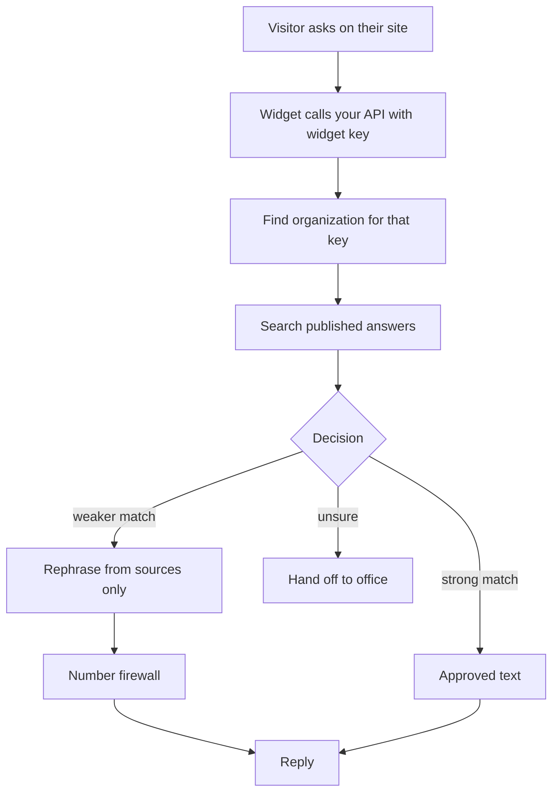

# Amakuru

**Verified FAQ assistant for organizations** — campuses, companies, NGOs, clinics, government offices, and any website that needs trustworthy answers.

Staff approve answers. The bot answers only from that bank. It does not invent facts. When unsure, it hands the visitor to the right office.

You host Amakuru. Each organization gets its own answer bank and its own embed snippet.

---

## Who uses what

| Person | What they do |
|--------|----------------|
| **You (Amakuru operator)** | Run the API + dashboard. Create organizations. Send each org their embed snippet. |
| **Org admin / staff** | Add or approve answers in the dashboard (or you do it for them). |
| **Website visitors** | Open the chat popup on the org’s site and ask questions. |

**Normal integrate path:** create org → get snippet → they paste it on their site → answers live in Amakuru.  
Their production database URL is **not** required for the chat to work, and must **never** go in the public snippet.

---

## How to use Amakuru (operator guide)

### 1. Sign in

Open the admin dashboard (local: http://localhost:3000).

After seed, demo login:

| | |
|--|--|
| Email | `admin@example.com` |
| Password | `ChangeMeNow123!` |

You land straight on the organization dashboard.

### 2. Create an organization

1. Open the **organization switcher** (top of the sidebar).
2. Click **New organization** (modal stays on the same screen).
3. Fill:
   - **Name** and **slug** (slug: at least 2 characters, e.g. `beta`)
   - Admin email / password for their staff login
   - Optional website origin (e.g. `https://their-site.com`)
   - **Answer source** (pick one):
     - Amakuru sample answers (quick demo)
     - Paste Q&A they shared with you
     - Read-only FAQ database URL (encrypted; optional)
     - FAQ API URL (optional)
     - Public website drafts (optional)
     - Empty (add answers later)
4. Click **Create organization**.
5. **Copy the embed snippet** (and widget key) in the modal — the full key is shown once.
6. Click **Done** to stay, or **Switch to this org** if you want that org’s dashboard.

Secrets such as a FAQ DB URL are stored encrypted on the server. They are **not** placed in the website script.

### 3. Give them the snippet

Send only this kind of HTML (with **their** live API URL and **their** widget key):

```html
<script>
  window.AmakuruConfig = {
    apiBase: "https://api.yourdomain.com",
    key: "ak_live_THEIR_WIDGET_KEY",
    language: "en"
  };
</script>
<script src="https://api.yourdomain.com/widget/amakuru-widget.js" defer></script>
```

They paste it before `</body>` on their site (or via their CMS).

Local testing:

- API + demo page: http://localhost:8000/widget/demo  
- Demo widget key (after seed): `ak_live_demo_university_key_change_me`

### 4. Fill the answer bank

Answers must exist in Amakuru for that org before the bot can help much.

| Method | When to use |
|--------|-------------|
| **Answers** screen | Type Q&A in the dashboard |
| Paste at create time | They already sent you a list |
| CSV / spreadsheet import | One-off bulk load |
| **Connectors** (under *More for this org*) | Ongoing pull from FAQ DB / API / website into **drafts** |

Connectors are optional. Imported rows become **drafts** until someone reviews and publishes.

### 5. Day-to-day dashboard

Sidebar essentials:

| Item | Use |
|------|-----|
| **Overview** | Activity snapshot |
| **Answers** | Create and manage the answer bank |
| **Embed** | Copy snippet / see widget settings |

Under **More for this org** (same organization only):

| Item | Use |
|------|-----|
| Connectors | Import from DB / API / site |
| Searches | What people asked |
| Conversations | Threads + why this answer |
| Review / Gaps / Expiring | Quality and governance |
| Team / Settings / Usage / Audit | Access, branding, metering |

Switch organizations anytime from the sidebar org switcher.

### 6. How a visitor question is answered

```text
Their website  →  Your Amakuru API  →  That org’s published answers in Amakuru DB
```

Not from inventing facts. Not from their live site database (unless you imported via Connectors into Amakuru first).



More diagrams: [docs/architecture/flows.md](docs/architecture/flows.md)

---

## Security rules for integrators

- **Public snippet** = API URL + widget key only  
- **Never** put database passwords or DSNs in `index.html` or GitHub  
- Prefer CSV or a read-only FAQ API over giving Amakuru a full production DB login  
- If you use a SQL connector, use a **read-only** FAQ user  
- Store operator secrets in `.env` (never commit `.env`)

---

## Quick start (developers)

**Prerequisites:** Docker Compose (or a Postgres URL such as Neon), Node 20+, Python 3.12+.

### 1. Environment

```bash
cp .env.example .env
# Set SECRET_KEY, ENCRYPTION_KEY, and DATABASE_URL if using hosted Postgres
```

Neon / libpq URLs are accepted; the API normalizes them for asyncpg (`ssl=require`).

### 2. Database

```bash
docker compose up -d postgres redis
# or point DATABASE_URL at Neon and skip local Postgres
```

### 3. Backend

```bash
cd backend
python3 -m venv .venv
source .venv/bin/activate
pip install -r requirements.txt
pip install -e .
alembic upgrade head
python -m amakuru.scripts.seed
uvicorn amakuru.main:app --host 0.0.0.0 --port 8000 --reload
```

- API: http://localhost:8000  
- Docs: http://localhost:8000/docs  
- Chat demo: http://localhost:8000/widget/demo  

Optional worker (connectors, search promotion, expiry):

```bash
cd backend && source .venv/bin/activate
python -m amakuru.worker
```

### 4. Admin dashboard

```bash
cd frontend
npm install
npm run dev
# → http://localhost:3000
```

### 5. Widget bundle

```bash
cd frontend/widget
npm install
npm run build
# served by the API at /widget/amakuru-widget.js
```

Demo content is labelled **demonstration only**. Do not invent real fees or contacts for a real institution.

---

## Repository layout

```text
AMAKURU/
  backend/           FastAPI API + worker
  frontend/          Admin dashboard (Vite + React JSX)
  frontend/widget/   Embeddable chat popup (Preact JSX)
  docs/              Architecture, compliance templates
  eval/              Golden sets / evaluation fixtures
  infra/             Postgres init, backups, Caddy
```

---

## Stack

| Layer | Choice |
|-------|--------|
| API | Python 3.12, FastAPI, SQLAlchemy 2 async, Alembic |
| DB | PostgreSQL + pgvector (+ RLS; app role optional on hosted Neon) |
| Cache / jobs | Redis; worker for sync and expiry |
| Admin | Vite, React (JSX), Tailwind, TanStack Query |
| Widget | Preact (JSX), Shadow DOM, one script tag |

---

## Configuration

[`.env.example`](.env.example) is the configuration contract.

| Setting | Meaning |
|---------|---------|
| `DATABASE_URL` | Postgres URL (local or Neon) |
| `ALLOW_PRIVATE_DB_CONNECTORS` | Allow SQL connectors to private/LAN hosts |
| `CONNECTOR_SYNC_INTERVAL_SECONDS` | Worker re-sync interval |
| `SEARCH_PROMOTE_MIN_COUNT` | Promote hot unanswered searches |
| `ALLOW_EXTERNAL_AI_CALLS` | `false` for self-hosted / sovereign LLM mode |
| `VITE_API_BASE_URL` | Dashboard → API base (default `http://localhost:8000`) |
| `API_BASE_URL` | Written into new embed snippets at org create time |

Organization secrets (WhatsApp tokens, connector DSNs) are encrypted in the database.

---

## Licence

Proprietary. See the project owner for licensing terms.
