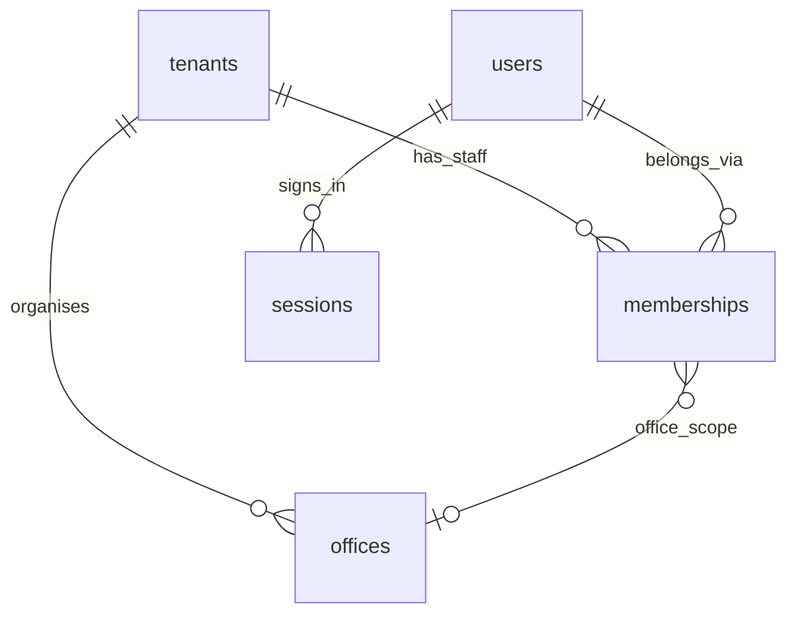
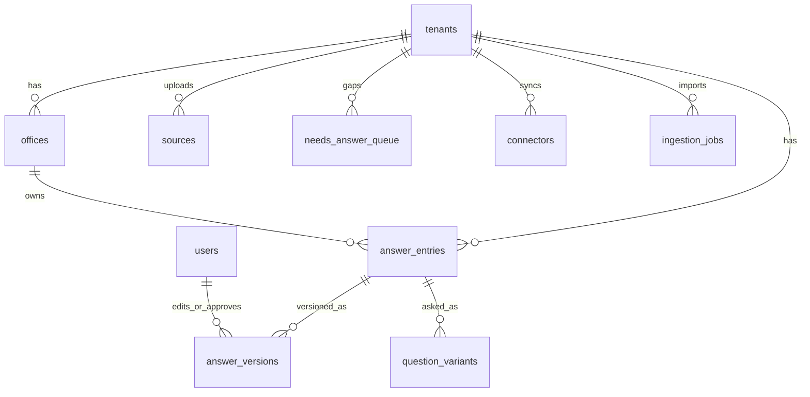
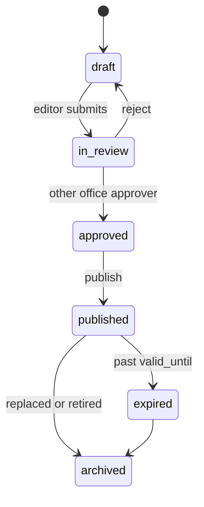
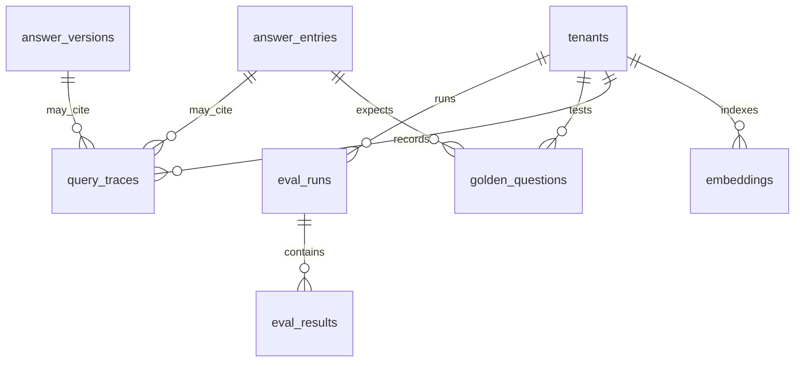
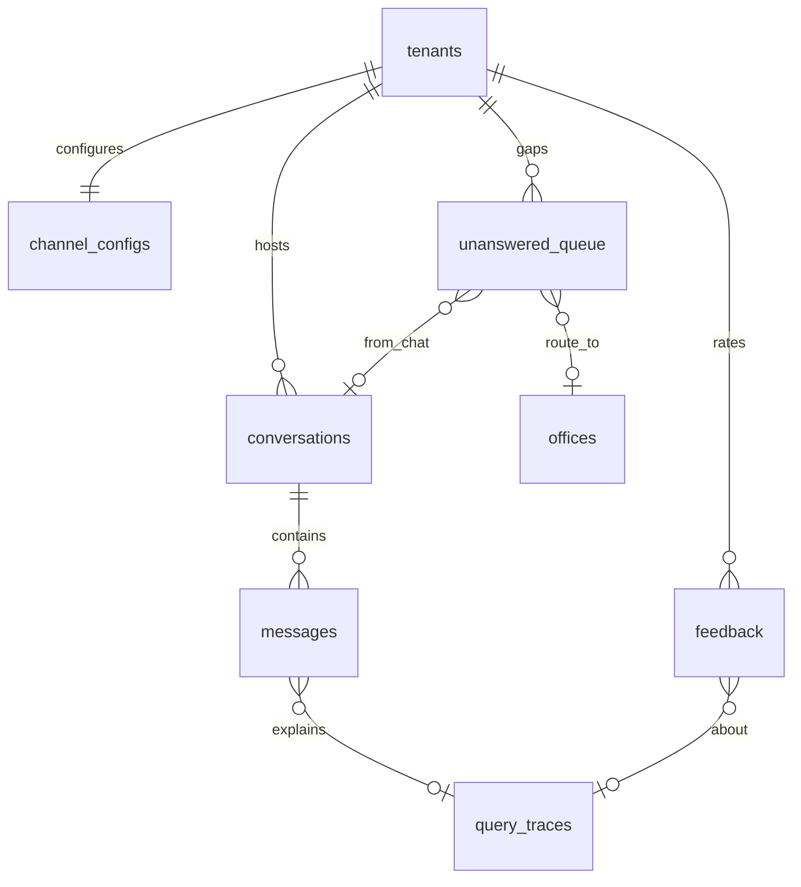
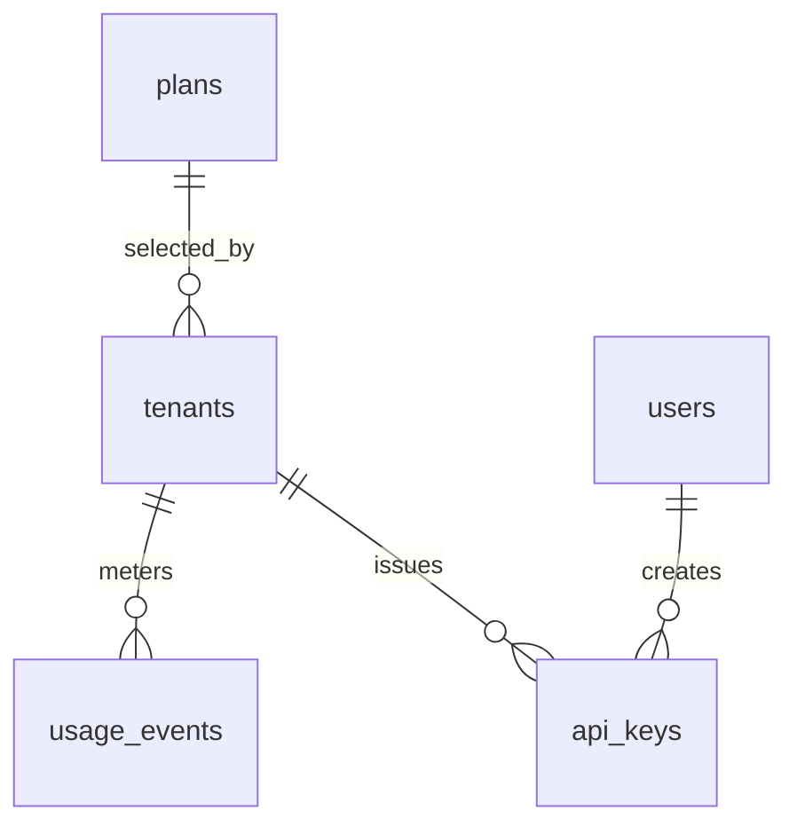
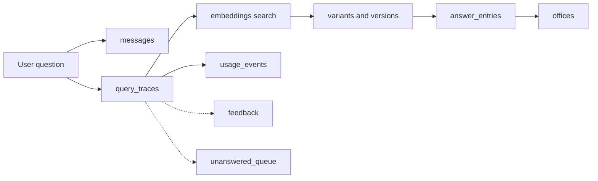

# Data model (ERDs)

Amakuru stores almost all product data in **PostgreSQL**. Every tenant-scoped table carries `tenant_id` and is protected by **Row Level Security** (`SET LOCAL app.tenant_id`). Platform tables such as `users`, `plans`, and `sessions` are not partitioned the same way.

Diagrams below are Mermaid ER diagrams (relationship-focused so GitHub can render them reliably). Each section explains **what the entities mean** and **how they connect**.

---

## 1. Tenancy, people and access

**What this is for:** which university (tenant) exists, which staff belong to it, and how they sign in.

| Entity | Explanation |
|--------|-------------|
| **tenants** | One university (or demo campus). Holds plan, branding tokens, residency mode. |
| **users** | Global login identity. Platform admins can onboard any tenant; others only see memberships they hold. |
| **memberships** | Role inside a tenant: `tenant_admin`, `office_editor`, `office_approver`, `analyst`, `viewer`. May be scoped to one office. |
| **sessions** | Dashboard cookie sessions and CSRF token. |
| **offices** | Registrar, Admissions, Finance, etc. They own answers and appear on hand-off cards. |

Key columns: `tenants.slug`, `tenants.plan`, `tenants.branding`; `memberships.role`; `users.email`, `users.totp_enabled`.

---

## 2. Knowledge bank (answers)

**What this is for:** the approved truth the bot is allowed to say. Stable **entries** point at immutable **versions**; real question wording is stored as **variants** for retrieval.

| Entity | Explanation |
|--------|-------------|
| **answer_entries** | Stable identity of one FAQ topic (category, owning office, flags like `verbatim_only`). |
| **answer_versions** | Immutable snapshot of the answer text and status (`draft` to `published` to `expired` or `archived`). Editor is not the approver. |
| **question_variants** | Exact wording people used, never tidied, used for dense and keyword retrieval. |
| **sources** | Uploaded circulars or fee documents that suggestions can cite. |
| **needs_answer_queue** | Import rows or topics that lack an official answer yet. |
| **connectors / ingestion_jobs** | Scheduled or file imports that always land as drafts needing human approval. |

**Lifecycle (status on `answer_versions`):**

---

## 3. Retrieval, traces and evaluation

**What this is for:** search indexes, why-this-answer audit of each question, and golden-set quality gates.

| Entity | Explanation |
|--------|-------------|
| **embeddings** | Dense (and optional sparse) vectors for question variants and answer versions; rebuilt when the embedding model changes. |
| **query_traces** | One row per asked question: pipeline steps, scored candidates, decision, latency, tokens, cost. Powers the admin why-this-answer screen. |
| **golden_questions** | Real wordings mapped to the correct entry or expected hand-off (the eval suite). |
| **eval_runs / eval_results** | Metrics (recall, MRR, top-one, and more) per run; publish can be blocked if scores fall outside tolerance. |

---

## 4. Channels and conversations

**What this is for:** widget and WhatsApp configuration, chat history, feedback, and unanswered clusters.

| Entity | Explanation |
|--------|-------------|
| **channel_configs** | Per-tenant widget key (hashed), allowed origins, WhatsApp secrets (encrypted), quick-topic chips. |
| **conversations / messages** | Session turns; assistant messages link to `query_traces` for explainability. Text is scrubbed; retention policy applies. |
| **unanswered_queue** | Hand-offs clustered for the Gaps screen (questions we cannot answer yet). |
| **feedback** | Thumbs up or down tied to a trace. |

---

## 5. Commercial (plans, usage, API keys)

**What this is for:** packaging and metering, not a payment gateway.

| Entity | Explanation |
|--------|-------------|
| **plans** | Catalogue rows for `starter`, `campus`, `enterprise` (limits and feature flags). Runtime checks also use the Python catalogue so code and DB stay aligned. |
| **usage_events** | Daily aggregates: answered conversations, tokens, WhatsApp messages, estimated cost, exported as CSV for invoicing. |
| **api_keys** | Hashed keys for `POST /api/v1/external/ask`; gated by `api_access` entitlement. |

---

## 6. Platform audit

`audit_log` is append-only: action, resource type/id, actor, optional tenant, detail JSON. The application role has no update or delete on this table.

---

## How the pieces join at answer time

1. The channel writes a **message** and runs the pipeline.  
2. A **query_trace** stores candidates and the decision.  
3. Retrieval hits **embeddings** built from **question_variants** / **answer_versions**.  
4. The chosen entry's **office** appears on the source or hand-off card.  
5. **usage_events** increment; weak answers may land in **unanswered_queue**; users may leave **feedback**.

For runtime topology (API, widget, Redis), see [overview.md](overview.md).
