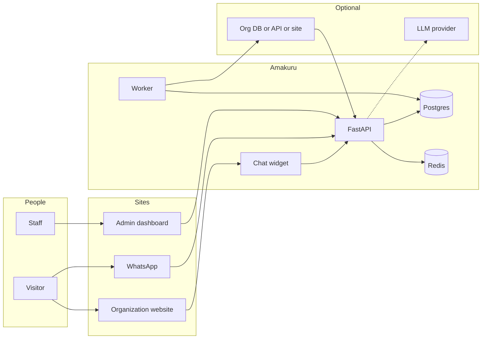
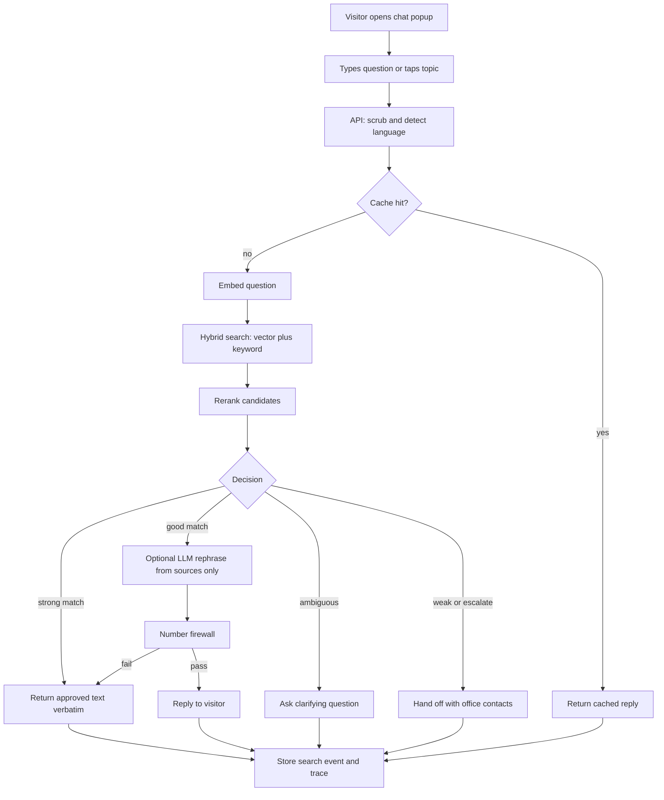
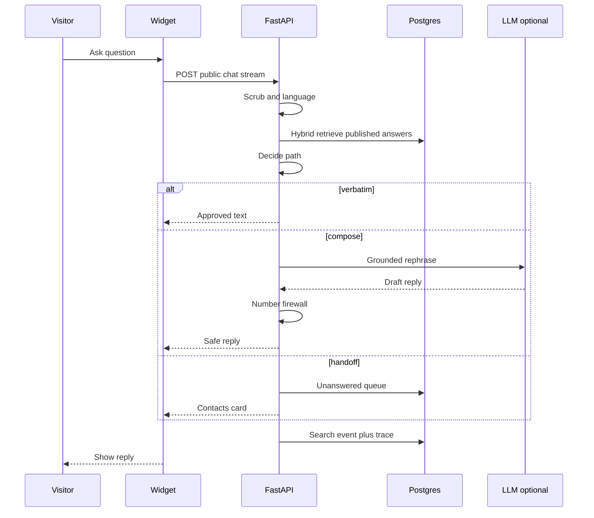
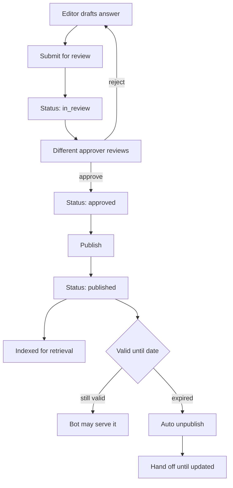
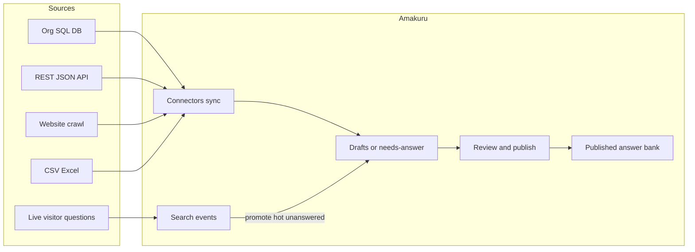
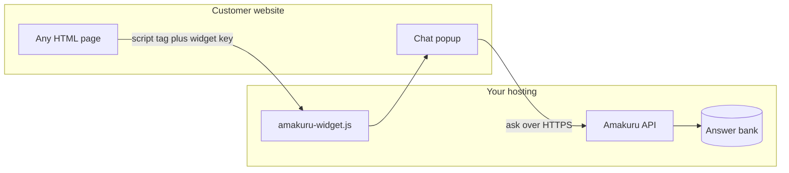
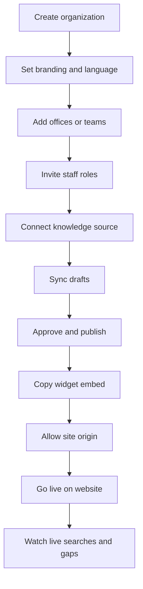
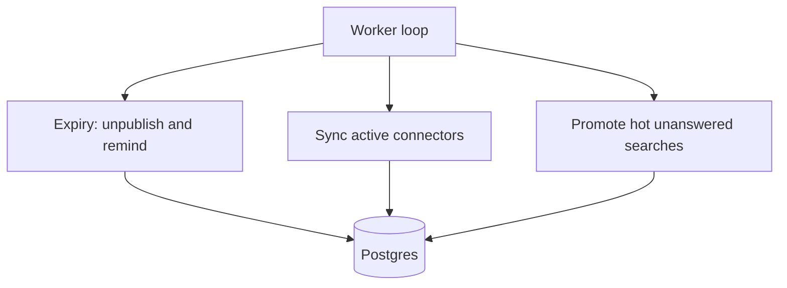
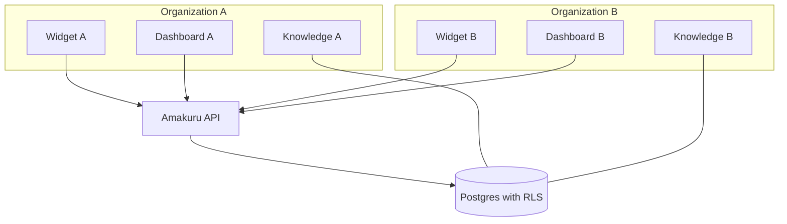

# User flows and diagrams

Mermaid diagrams for Amakuru. They render on GitHub and in most Markdown previews.

Related: [overview.md](overview.md) · [data-model.md](data-model.md)

---

## 1. System context

Who uses what, and what Amakuru talks to.



---

## 2. Visitor ask flow

End-to-end path when someone asks a question on the widget (or WhatsApp / API).



---

## 3. Sequence: widget ask



---

## 4. Staff governance flow

How answers become live. Editors do not approve their own versions.



---

## 5. Knowledge intake flow

Connectors and live searches feed drafts. Humans still publish.



---

## 6. Embed on a customer site

You host Amakuru. Their site only loads the popup script.



Embed snippet (replace host and key):

```html
<script>
  window.AmakuruConfig = {
    apiBase: "https://api.yourdomain.com",
    key: "ak_live_CUSTOMER_KEY",
    language: "en"
  };
</script>
<script src="https://api.yourdomain.com/widget/amakuru-widget.js" defer></script>
```

---

## 7. Organization onboarding flow



---

## 8. Worker jobs



---

## 9. Multi-organization isolation



Row Level Security ensures A never reads B’s data (and the reverse).

---

## Where to look in code

| Flow | Main code |
|------|-----------|
| Ask pipeline | `backend/src/amakuru/modules/retrieval/service.py` |
| Widget chat | `backend/src/amakuru/modules/channels/` · `frontend/widget/` |
| Governance | `backend/src/amakuru/modules/knowledge/` |
| Connectors | `backend/src/amakuru/modules/knowledge/adapters/` · dashboard **Connectors** |
| Live searches | `backend/src/amakuru/modules/knowledge/search_intel.py` · dashboard **Live searches** |
| Worker | `backend/src/amakuru/worker.py` |
| Embed demo | http://localhost:8000/widget/demo |
