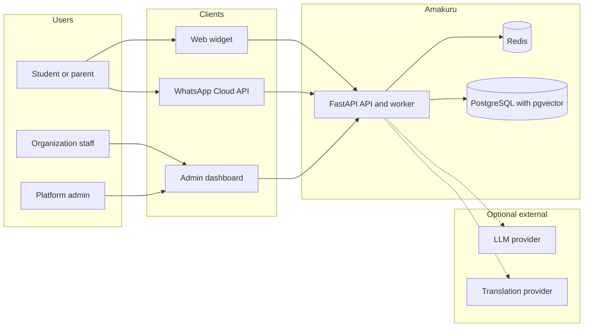
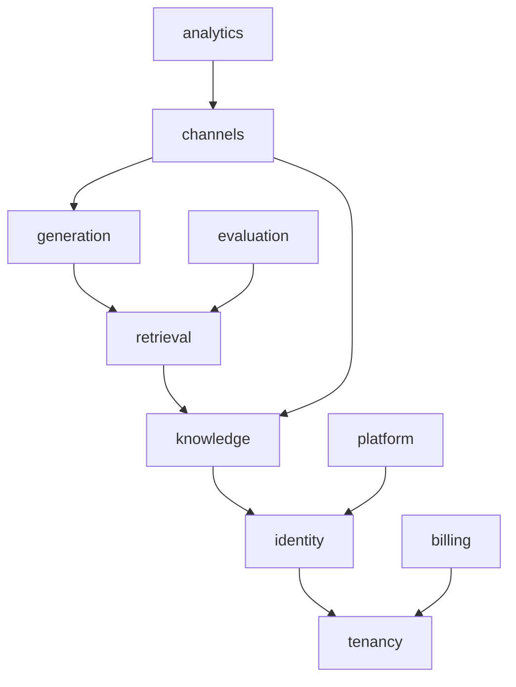
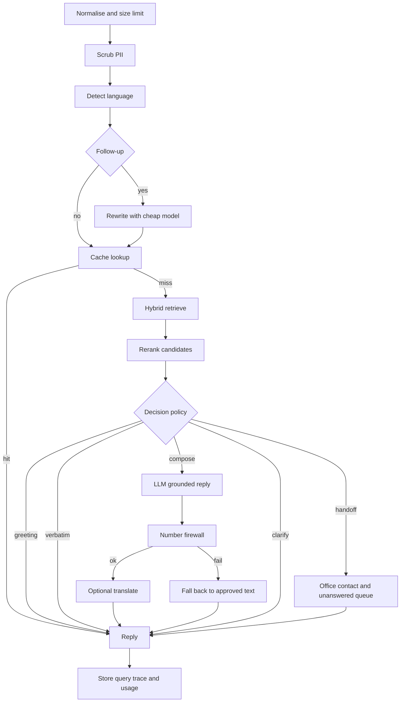
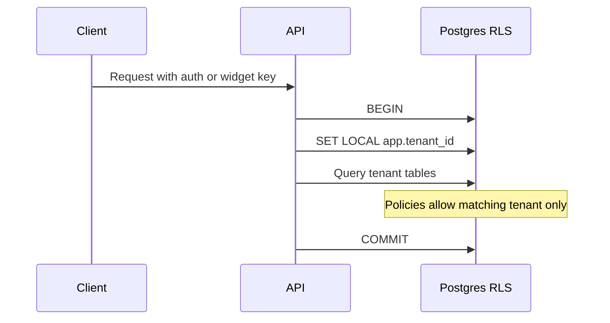
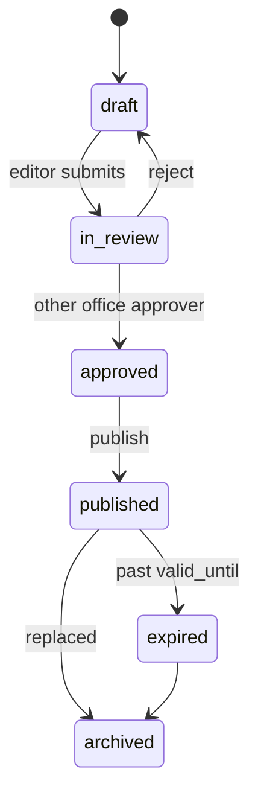

# Architecture overview

Amakuru is a verified FAQ assistant for organizations (universities, companies, sites, and other teams): one FastAPI API, one worker, one Vite React (JSX) admin app, and one Preact (JSX) widget bundle. Configure one organization at a time.

**User flows and more diagrams:** [flows.md](flows.md)

## System context

Who talks to what in production (or on a single VPS with Docker Compose).

| Piece | Path | Role |
|-------|------|------|
| API | `backend/` | Auth, knowledge, retrieval, generation, channels, billing, analytics |
| Admin | `frontend/` | Office workflows and why-this-answer traces (Vite React, JSX) |
| Widget | `frontend/widget/` | Shadow DOM embed (small gzip bundle, Preact JSX) |
| Data | PostgreSQL 16 with pgvector | Relational data, vectors, FTS, RLS |
| Cache | Redis 7 | Reply cache, rate limits, background jobs |

**Repo layout:** `backend/`, `frontend/`, `frontend/widget/`, `packages/api-client`, `eval/`, `docs/`, `infra/`.

## Module boundaries

Modules talk through typed services. They never query another module's tables directly.

| Module | Scope |
|--------|--------|
| `identity` | Users, sessions, memberships, CSRF, TOTP |
| `tenancy` | Organizations (tenants), branding |
| `knowledge` | Offices, answer entries/versions, import, connectors, expiry |
| `retrieval` | Embeddings, hybrid search, rerank, decision policy, traces |
| `generation` | LLM gateway, compose, number firewall, scrubber, translation |
| `channels` | Widget chat, WhatsApp webhook, hand-off, unanswered queue |
| `billing` | Plans, entitlements, metering, API keys, onboarding |
| `analytics` | Dashboard aggregates |
| `evaluation` | Golden sets, eval runs |
| `platform` | Health, metrics, audit log |

## Query pipeline

| Path | Meaning |
|------|---------|
| **verbatim** | Return approved text as written (no LLM cost) |
| **compose** | Short grounded rewrite; firewall discards invented numbers or contacts |
| **clarify** | Ask one question when candidates differ only by applicability |
| **hand-off** | Honest uncertainty plus office contacts |

## Tenant isolation

The `amakuru_app` role has `NOBYPASSRLS`. Isolation tests under `backend/tests/isolation/` must stay green.

## Knowledge lifecycle

Editor of a version cannot approve it. Expiry reminders fire at 30 / 14 / 3 days.

## Data model (ERDs)

Entity-relationship diagrams for each domain (tenancy, knowledge, retrieval, channels, billing), with explanations:

→ **[data-model.md](data-model.md)**

## Related docs

- [ADRs](../adr/) - significant design choices  
- [Runbooks](../runbooks/) - common incidents  
- [Compliance templates](../compliance/) - Uganda DPPA-oriented drafts (not legal advice)  
- [OpenAPI](../api/openapi.json) - generated API contract  
